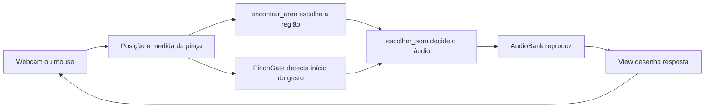
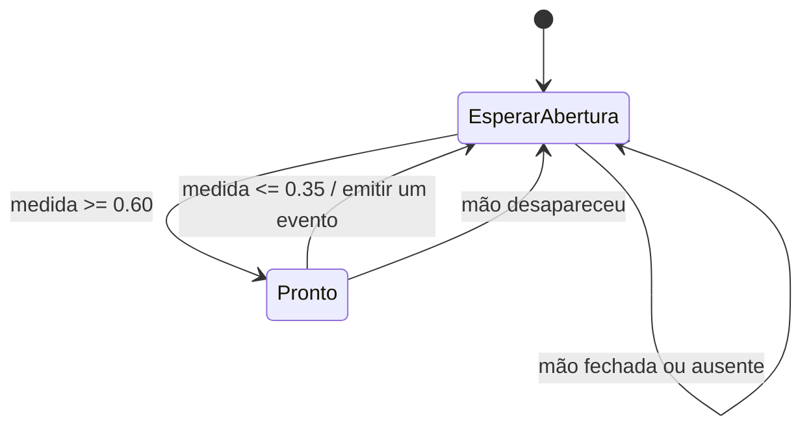

# Mapa do código para o professor

## Por onde começar

Abra `versions/day1/project.py` primeiro. Ele contém todo o código que a turma
precisa dominar para terminar a primeira noite: uma lista de dicionários e duas
funções. A infraestrutura usa classes para manter estado e recursos, mas os alunos
não precisam aprender orientação a objetos para concluir as atividades.

As funções e os dados das atividades usam português. Os módulos de apoio mantêm
alguns nomes internos em inglês; o [glossário](GLOSSARY.md) explica essa fronteira
e o significado dos termos usados no código.

Execute a referência com mouse antes de estudar a câmera:

```powershell
.\.venv\Scripts\python.exe app.py --version instructor --input mouse
```

## Caminho de um quadro

O programa repete o ciclo abaixo, buscando aproximadamente 30 quadros por segundo.
O desempenho real depende da câmera e do computador.



No `workshop/runtime.py`, procure o comentário **As duas funções abaixo**. Esse
trecho é a ponte para o arquivo escolhido por `--version`:

```python
area_selecionada = projeto.encontrar_area(areas, *cursor) if cursor is not None else None
pinca_iniciada = pinch.update(observation.pinch_ratio, now)
som = projeto.escolher_som(area_selecionada, pinca_iniciada)
```

`*cursor` entrega os dois valores da tupla como argumentos separados: `x` e `y`.
`None` representa ausência de seleção ou de mão; não representa uma coordenada.
As câmeras e janelas ficam fora do arquivo de atividades para os alunos poderem
experimentar sem precisar reconstruir a integração a cada etapa.

## O formato de uma área sonora

Cada região interativa é uma área sonora, que também pode ser um pad de bateria.

```python
{
    "id": "bumbo",
    "rotulo": "BUMBO",
    "som": "kick.wav",
    "retangulo": (0.10, 0.20, 0.37, 0.29),
    "cor": (55, 220, 190),
}
```

- `id`: identificador único usado para lembrar animações e batidas.
- `rotulo`: texto desenhado no pad.
- `som`: arquivo dentro de `assets/sounds/`, carregado uma vez na inicialização.
- `retangulo`: esquerda, topo, largura, altura, em coordenadas normalizadas.
- `cor`: RGB, cada canal entre 0 e 255.
- `imagem`: campo opcional, nome de PNG dentro de `assets/images/`.

Na tela, `(0, 0)` é o canto superior esquerdo do vídeo e `(1, 1)` é o inferior
direito. Y cresce para baixo. O primeiro pad termina em `x = 0.47` e `y = 0.49`.
Uma posição `(0.20, 0.30)` está dentro dele.

`encontrar_area` usa o limite esquerdo/superior inclusivo e direito/inferior exclusivo.
Assim, dois pads adjacentes não reivindicam o mesmo ponto da borda. Evite
sobreposição; se houver, o primeiro pad da lista ganha a seleção.

O desenho converte as coordenadas para pixels da área `STAGE`, sem incluir o
cabeçalho e o rodapé. A janela se ajusta ao tamanho do desktop e pode ser
redimensionada; as posições do mouse são convertidas para o mesmo canvas lógico
usado no desenho. A câmera é recortada para 16:9 e espelhada **antes** da
inferência. O desenho usa exatamente essa imagem, mantendo cursor e vídeo alinhados.

## O que o modelo faz

`workshop/tracking.py` abre a webcam com OpenCV. O MediaPipe Hand Landmarker recebe
o quadro RGB e devolve 21 pontos da mão. Usamos:

| Índice | Ponto | Uso |
| --- | --- | --- |
| 4 | Ponta do polegar | Distância da pinça |
| 8 | Ponta do indicador | Cursor e distância da pinça |
| 5 | Base do indicador | Referência para largura da palma |
| 17 | Base do dedo mínimo | Referência para largura da palma |

A medida é `distância(4, 8) / distância(5, 17)`. As distâncias usam largura e altura
em pixels, evitando tratar eixos de proporções diferentes como se fossem iguais.
Dividir pela palma reduz a dependência da distância até a câmera. Essa regra ainda
é uma aproximação: rotação, oclusão e iluminação podem afetar o rastreamento.

O modelo estima pontos. **As regras de tocar som são código nosso**, sem treinamento
de um modelo musical. O programa usa uma mão e processamento síncrono no modo
VIDEO da API Tasks, com timestamps sempre crescentes. O nome VIDEO também serve
para processar quadros sucessivos capturados da webcam.

## Por que existe PinchGate

Se o programa tocar enquanto os dedos estiverem fechados, tentará tocar novamente
a cada quadro. Um gesto de um segundo poderia provocar dezenas de acionamentos.
Precisamos reconhecer uma mudança de estado.



Em `workshop/gestures.py`:

- `armed` lembra se uma abertura já autorizou a próxima pinça.
- `closed` registra a condição de fechamento; `pinca_iniciada` é o evento de um único quadro.
- Dois limiares criam uma faixa neutra: valores entre `0.35` e `0.60` não mudam a autorização.
- `last_trigger` e `cooldown` limitam acionamentos excessivamente próximos.
- Uma pinça durante o cooldown é consumida: não dispara mais tarde só porque continuou fechada.
- Perder a mão remove a autorização. Reaparecer de pinça fechada não deve tocar.

O evento é consumido mesmo fora dos pads. Fechar a pinça fora e entrar em uma região
mantendo-a fechada não toca; é necessário soltar e fazer uma nova pinça.

O aluno recebe `pinca_iniciada` pronto para escrever a decisão em `escolher_som`.
Depois, você pode abrir a implementação do gate para explicar de onde veio esse
booleano e por que o programa precisa lembrar algo do quadro anterior.

## Áudio e resposta visual

`workshop/audio.py` carrega todos os WAVs antes do laço. `AudioBank.play` escolhe um
dos 32 canais disponíveis. A reprodução continua enquanto o próximo quadro é
processado. Sons diferentes podem se sobrepor; uma nota não precisa terminar para
outra começar. Se todos os canais estiverem ocupados, o mixer pode reutilizar um.

O volume é aplicado ao canal daquele toque, permitindo intensidades independentes.
O estado `flashes` armazena o instante até quando cada pad deve ficar aceso, por
0,18 segundo. Não usamos `sleep` para esperar som ou animação.

`workshop/drawing.py` desenha a janela com Pygame: vídeo de fundo, texto, pads,
formas de onda, imagens opcionais, mão e cursor. OpenCV fica com captura e
processamento de imagem. Essa escolha mantém uma janela com fontes e eventos de
mouse/teclado consistentes no Windows.

## Extensões da segunda noite

### Teclado

`criar_areas("teclado")` cria cinco retângulos altos e muda os arquivos para notas.
Na linha de comando, essa escolha continua sendo `--instrument keyboard`; a
tabela `INSTRUMENTOS` no runtime faz a conversão para o valor em português.
O reconhecimento e `escolher_som` continuam iguais. Isso demonstra reutilização:
novos dados geram um instrumento diferente com as mesmas regras.

Com `V`, `volume_pela_altura(y)` devolve `1 - y`, limitado de `0.2` a `1`. A nota
recebe esse volume no momento de tocar; não é um controle contínuo de uma nota
já em reprodução. As amostras são notas curtas, sem sustain ou acordes por múltiplos dedos.

### Bateria por descida

Com `B`, `StrikeGate` substitui o gatilho da pinça. Ele compara posições em quadros
consecutivos e mede velocidade vertical em alturas de tela por segundo.

Uma batida exige cruzar a borda superior descendo, com velocidade mínima. O ponto
horizontal de cruzamento é interpolado, permitindo trajetórias diagonais. Após
uma batida, o cursor precisa subir acima da borda com uma margem de rearme.
Perda de mão ou intervalo de mais de 0,25 segundo entre observações interrompe a
continuidade. O modo é uma aproximação lúdica de bateria, sem rastreamento de
baquetas físicas ou sincronização musical precisa.

## Responsabilidades dos arquivos

| Arquivo | Quando ler/editar |
| --- | --- |
| `app.py` | Escolher versão, entrada e opções; entender argumentos depois da aula |
| `versions/*/project.py` | Principal arquivo das atividades |
| `workshop/runtime.py` | Ver a integração e o ciclo de cada quadro |
| `workshop/gestures.py` | Estudar memória, histerese e batidas |
| `workshop/tracking.py` | Entender pontos, proporções e timestamps |
| `workshop/audio.py` | Entender pré-carregamento e sobreposição |
| `workshop/drawing.py` | Personalizar a apresentação visual além dos pads |
| `workshop/config.py` | Validação de layouts e caminho absoluto do projeto |
| `tests/test_core.py` | Exemplos executáveis dos casos de interação |
| `tests/test_integration.py` | Janela simulada, som sobreposto e modelo real |

## Referências primárias

- [API Hand Landmarker e exemplo Python](https://developers.google.com/edge/mediapipe/solutions/vision/hand_landmarker?tab=Python).
- [Pygame mixer: sons e canais](https://www.pygame.org/docs/ref/mixer.html).
- [OpenCV VideoCapture](https://docs.opencv.org/4.x/d8/dfe/classcv_1_1VideoCapture.html).
- [Pygame draw](https://www.pygame.org/docs/ref/draw.html).

